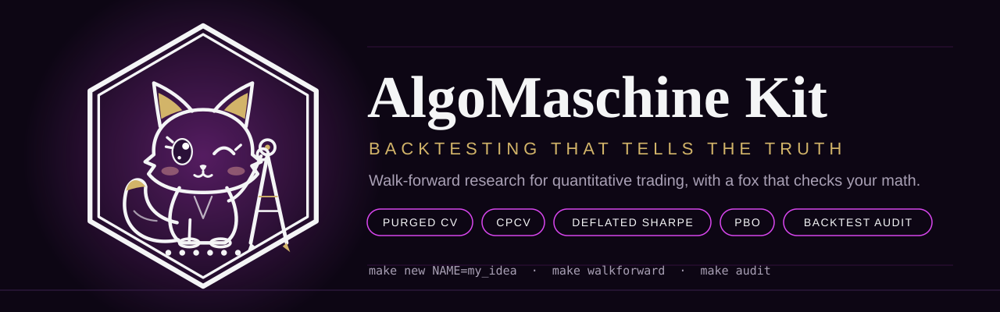
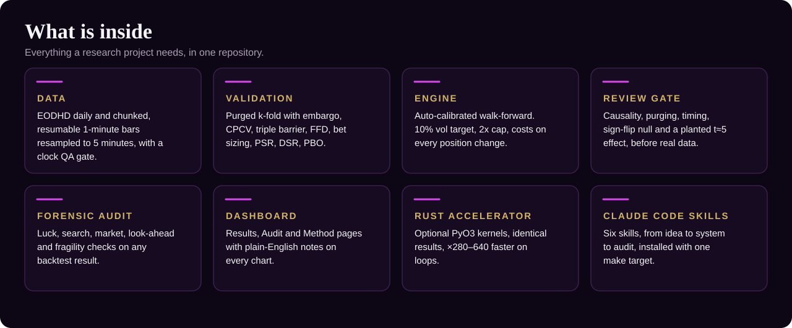

<p align="center"></p>

<p align="center">
  <a href="LICENSE"></a>
  
  
  
</p>

# AlgoMaschine Kit: walk-forward backtesting framework for quantitative trading

**algomaschine-kit** is a Python toolkit for building and testing quantitative trading strategies without fooling yourself.
You describe how the alpha signal is generated and which extra data it needs; the kit turns it into a pre-registered,
reviewed, auto-calibrated **walk-forward backtest** with **purged cross-validation**, **CPCV**, the **deflated Sharpe ratio (DSR)**,
the **probability of backtest overfitting (PBO)**, and a forensic **backtest audit** that checks for luck, selection bias,
look-ahead and fragility. It follows the methods of López de Prado's *Advances in Financial Machine Learning* (AFML), ships
[Claude Code](https://claude.com/claude-code) skills, and has an optional Rust accelerator.

Good for: strategy research, overfitting checks, alpha research on FX, equities, ETFs, commodities and crypto, and anyone who
wants an honest answer to "is this backtest real?".

## How it works
<p align="center"></p>

## Quick start
```bash
make -C ~/algomaschine-kit install-skills          # once: Claude Code skills available everywhere
make -C ~/algomaschine-kit new NAME=my_idea        # a project in ~/projects/my_idea
cd ~/projects/my_idea && $EDITOR IDEA.md           # or just tell Claude the idea (skill: quant-idea-to-system)
make data qa          # EODHD quotes + clock QA gate
make spec-lock        # freeze SPEC.md + the configuration grid (pre-registration)
make review           # gate: causality, purging, timing, sign-flip null, planted t~5 effect
make walkforward      # auto-calibrated walk-forward (capped systemd job, survives logout, monitored)
make report serve     # PBO, CPCV, deflated Sharpe -> dashboard URL (token-protected)
make audit            # the too-good-to-be-true audit: luck, search, market, look-ahead, fragility
make help             # everything else (status, logs, rust, backup, spec-bump)
```

## What is inside
<p align="center"></p>

| Path | What |
|---|---|
| `amq/data` | EODHD daily + chunked resumable intraday (1m -> 5m), `known_before`, the clock QA gate |
| `amq/afml` | purged k-fold + embargo, CPCV paths, uniqueness, triple barrier, trend scanning, CUSUM filter, FFD (+ d* by ADF), Merrill filtered waves, bet sizing, average active bets, PSR, DSR, PBO (CSCV), bootstrap Sharpe CI, Newey-West t, Holm/BH |
| `amq/engine` | the generic auto-calibrated walk-forward (`Strategy` interface), money management (10% vol target, 2x cap, costs on position changes), selection among many rules (expected false picks under a robust empirical null) |
| `amq/review` | the pre-run review gate |
| `amq/audit` | the forensic audit of any result: bootstrap CI, PSR/DSR, MinTRL/MinBTL, haircut Sharpe, Lo; Reality Check/SPA, PBO, plateau; random timing, Sharpe difference vs buy-and-hold, HAC alpha, Treynor–Mazuy; plausibility, delay profile, rebuilt returns, point-in-time rebuilds, provenance; costs, leverage, stability, top days, one year, tails, bet count |
| `amq/report` | results JSON (with the trial ledger) + the AlgoMaschine dashboard: Results, Audit and Method pages, plain-English explanations on every chart, full-screen charts |
| `amq/ops` | resource monitor/guard for systemd jobs, benchmark |
| `mk/*.mk` | pipeline targets included by every project |
| `templates/project` | IDEA.md, SPEC.md, config.toml, strategy.py (working example), sources.py |
| `skills/` | Claude Code skills: quant-idea-to-system, afml-validation, backtest-audit, eodhd-data, walkforward-ops, algomaschine-reports |
| `rust/relay_core` | optional Rust accelerator (PyO3): identical results, x280-640 on loops (`make rust`, `make bench`) |
| `brand/` | logotype, mark, validated palette |

## Principles (learned the hard way)
1. Pre-register, then freeze; every configuration counts as a trial, forever (the ledger).
2. No walk-forward on real data before the review passes; tune machinery only on synthetic data.
3. A signal completed by a price is never traded at that price (enter at the next close).
4. Judge out of sample, deflate for trials, check PBO and CPCV paths, costs x2, halves, and audit anything that looks good.
5. Ask where an edge sits: illiquid hours, quote-source switches, missing carry, dividends, stale-index
   autocorrelation have all faked edges before.

## Requirements
Python 3.11, `make`, and an [EODHD](https://eodhd.com) API token in `.env` (chmod 600) for the data step. The Rust accelerator
(`make rust`) is optional and needs a Rust toolchain and `maturin`. The skills target [Claude Code](https://claude.com/claude-code).

## Disclaimer
Research software for testing trading ideas, not investment advice. A passing backtest is evidence about the past, not a promise.
Released under the MIT License (see `LICENSE`).

## Keywords
backtesting, walk-forward analysis, quantitative finance, algorithmic trading, trading strategy research, purged k-fold
cross-validation, combinatorial purged cross-validation (CPCV), deflated Sharpe ratio, probabilistic Sharpe ratio,
probability of backtest overfitting, triple-barrier labeling, meta-labeling, fractional differentiation, bet sizing,
multiple-testing correction (Holm, Benjamini-Hochberg), White Reality Check, Hansen SPA, alpha research, Python, Rust, EODHD.
